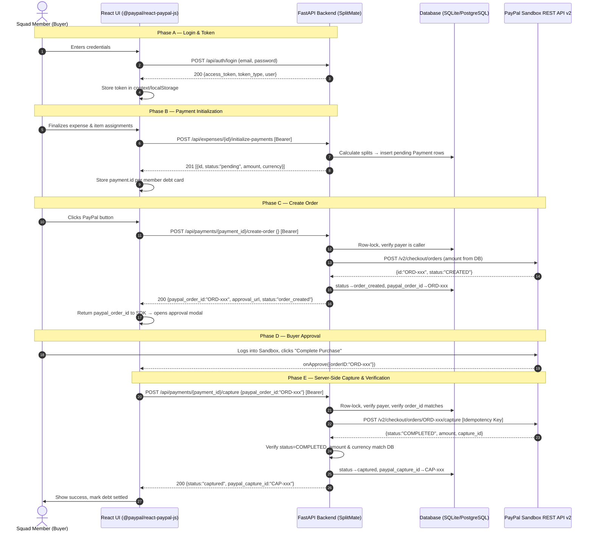
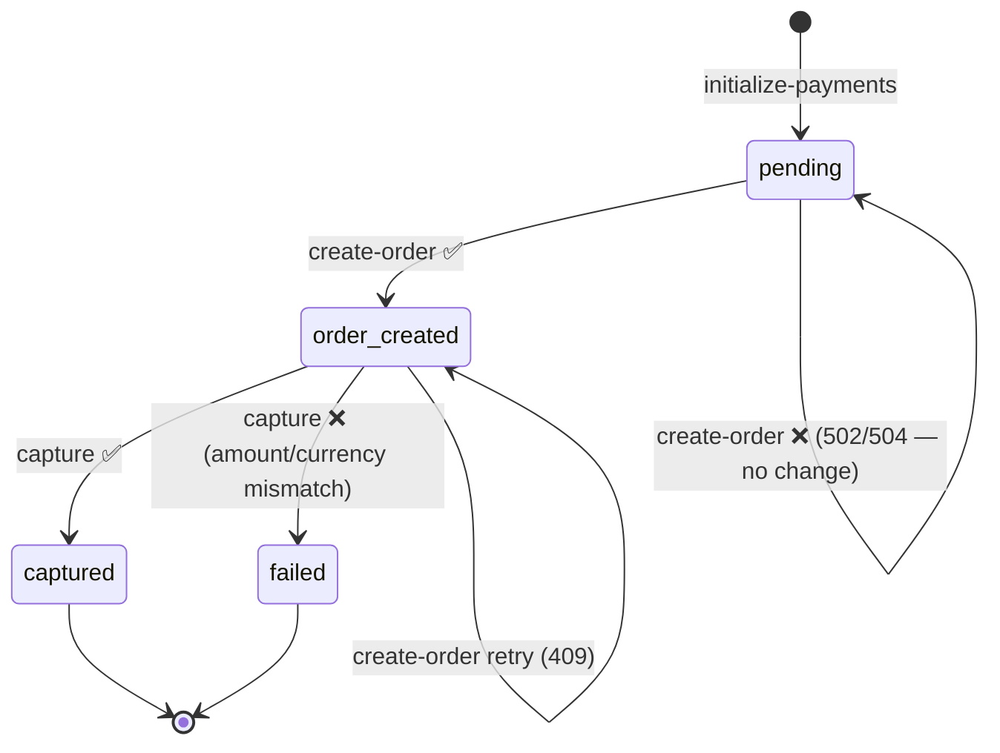

# PAYPAL_PHASE9_FRONTEND_HANDOFF.md

**Project:** SplitMate — PayPal AI Hackathon  
**Document Version:** 2.0 (supersedes `PAYPAL_REACT_INTEGRATION_CONTRACT.md` v1.0)  
**Date:** 2026-11-10  
**Backend Baseline:** Phase 8 security review — 90/90 tests passing  
**Author:** Tanay — PayPal Sandbox Integration Lead  
**Recipient:** Dhruv — React Frontend Developer  
**Reviewers:** Tanishq (Backend Auth), Tanay (PayPal)

---

> [!IMPORTANT]
> **Breaking change from v1.0 contract:** All six payment endpoints and all expense/group endpoints now require a **`Authorization: Bearer <token>` header**. JWT authentication is complete and enforced. The old contract's §7 ("Authentication Dependencies Requiring Tanishq's Approval") is fully resolved. The `member_id` body field is no longer the authorization gate — the JWT token is.

---

## 1. Architecture Overview



---

## 2. Authentication — What Changed and What Dhruv Must Do

### 2.1 JWT Token Flow

| Step | Endpoint | Method |
|---|---|---|
| Register | `POST /api/auth/register` | No auth required |
| Login | `POST /api/auth/login` | No auth required |
| All other API calls | _any_ | **`Authorization: Bearer <token>` required** |

**Login request:**
```json
POST /api/auth/login
Content-Type: application/json

{
  "email": "dhruv@splitmate.io",
  "password": "Password123!"
}
```

**Login response:**
```json
{
  "access_token": "eyJhbGciOiJIUzI1NiIsInR5cCI6IkpXVCJ9...",
  "token_type": "bearer",
  "user": {
    "id": "d4f2a1c0-...",
    "name": "Dhruv",
    "email": "dhruv@splitmate.io",
    "created_at": "2026-11-10T10:00:00Z"
  }
}
```

**How to attach the token to all API calls:**
```js
// In your api/client.js or axios interceptor
const token = localStorage.getItem('splitmate_token'); // or from React context

fetch('/api/payments/{id}/create-order', {
  method: 'POST',
  headers: {
    'Content-Type': 'application/json',
    'Authorization': `Bearer ${token}`,   // ← REQUIRED on every request
  },
  body: JSON.stringify({})
});
```

### 2.2 Payer Identity Enforcement

> [!WARNING]
> **The JWT token IS the payer identity. The `member_id` body field no longer controls authorization.**

The backend matches the JWT caller to the payment's owning `GroupMember` by either:
- `GroupMember.user_id == jwt_user.id` (FK match — preferred)
- `GroupMember.email.lower() == jwt_user.email.lower()` (email fallback)

**Implication:** When Dhruv creates a group member, the member's `email` must match the email the user registered with. Otherwise the payer check will fail with 403.

---

## 3. Exact API Contracts (Current — Verified Against Source Code)

### 3.1 Payment Initialization

> **Required before any PayPal order can be created.**

```
POST /api/expenses/{expense_id}/initialize-payments
Authorization: Bearer <token>
```

**Prerequisites (enforced by backend):**
- Every receipt item must be 100% assigned (partial → `400`)
- No payment may already be `order_created` or `captured` (→ `409`)

**Response `201 Created` — `list[PaymentResponse]`:**
```json
[
  {
    "id": "e93817f2-1a48-4cb2-850d-b4b1a4157121",
    "expense_id": "673f8a0a-bf19-4cb5-8278-f71694b7dc6a",
    "member_id": "3bf54bb5-3dc0-4581-9b65-ea933b9c7b64",
    "amount": "10.80",
    "currency": "USD",
    "paypal_order_id": null,
    "paypal_capture_id": null,
    "status": "pending",
    "approval_url": null,
    "created_at": "2026-11-10T10:00:00Z",
    "updated_at": "2026-11-10T10:00:00Z"
  }
]
```

> [!NOTE]
> `amount` is a **string-encoded decimal** in the response (`"10.80"`, not `10.80`). Parse with `parseFloat()` or a decimal library for display — do not use for server-side calculations.

---

### 3.2 Create PayPal Order — Primary Endpoint ✅ Recommended

```
POST /api/payments/{payment_id}/create-order
Authorization: Bearer <token>
Content-Type: application/json
```

**Request body** (`PaymentCreateOrderRequest` — all fields optional):
```json
{}
```
*(Body may be empty `{}`. `member_id`, `return_url`, `cancel_url` are accepted but not required for authorization.)*

**Response `200 OK` — `PaymentResponse`:**
```json
{
  "id": "e93817f2-1a48-4cb2-850d-b4b1a4157121",
  "expense_id": "673f8a0a-bf19-4cb5-8278-f71694b7dc6a",
  "member_id": "3bf54bb5-3dc0-4581-9b65-ea933b9c7b64",
  "amount": "10.80",
  "currency": "USD",
  "paypal_order_id": "5O190127TN364715T",
  "paypal_capture_id": null,
  "status": "order_created",
  "approval_url": "https://www.sandbox.paypal.com/checkoutnow?token=5O190127TN364715T",
  "created_at": "2026-11-10T10:00:00Z",
  "updated_at": "2026-11-10T10:00:01Z"
}
```

**The SDK's `createOrder` callback must return `response.paypal_order_id` (the string).**

---

### 3.3 Capture Payment — Primary Endpoint ✅ Recommended

```
POST /api/payments/{payment_id}/capture
Authorization: Bearer <token>
Content-Type: application/json
```

**Request body** (`PaymentCaptureRequest`):
```json
{
  "paypal_order_id": "5O190127TN364715T"
}
```

*(`member_id` is accepted for backward compatibility but ignored for authorization.)*

**Response `200 OK` — `PaymentResponse`:**
```json
{
  "id": "e93817f2-1a48-4cb2-850d-b4b1a4157121",
  "expense_id": "673f8a0a-bf19-4cb5-8278-f71694b7dc6a",
  "member_id": "3bf54bb5-3dc0-4581-9b65-ea933b9c7b64",
  "amount": "10.80",
  "currency": "USD",
  "paypal_order_id": "5O190127TN364715T",
  "paypal_capture_id": "1AB23456CD789012E",
  "status": "captured",
  "approval_url": null,
  "created_at": "2026-11-10T10:00:00Z",
  "updated_at": "2026-11-10T10:01:15Z"
}
```

**Confirm payment success only when `response.status === "captured"`.**

---

### 3.4 Frontend Compatibility Endpoints (Alternative)

Use these if the existing React context already calls `/api/payments/paypal/*`:

#### Create Order (Compatibility)
```
POST /api/payments/paypal/create-order
Authorization: Bearer <token>
Content-Type: application/json
```
```json
{
  "paymentId": "e93817f2-...",
  "payerId":   "3bf54bb5-...",
  "expenseId": "673f8a0a-..."
}
```
Lookup priority: `paymentId` → `payerId+expenseId` → `payerId` alone → JWT caller's pending payment.

#### Capture Order (Compatibility)
```
POST /api/payments/paypal/capture-order
Authorization: Bearer <token>
Content-Type: application/json
```
```json
{
  "orderId":   "5O190127TN364715T",
  "paymentId": "e93817f2-..."
}
```
Lookup priority: `paymentId` → `orderId` (matches `paypal_order_id` on Payment record).

> [!NOTE]
> Both camelCase (`paymentId`) and snake_case (`payment_id`) are accepted by the schema due to `model_config = {"populate_by_name": True}`.

---

### 3.5 Read Endpoints

| Endpoint | Auth | Description |
|---|---|---|
| `GET /api/payments/{id}` | Bearer | Returns single payment. Caller must be payer or group member. Non-members get 404 (IDOR protection). |
| `GET /api/payments/history` | Bearer | Returns up to 100 payments scoped to the authenticated user's payments and groups, newest first. |

---

## 4. PayPal React SDK Integration Pattern

### 4.1 Installation
```bash
npm install @paypal/react-paypal-js
```

**`.env` (frontend):**
```env
VITE_PAYPAL_CLIENT_ID=AYour_Sandbox_Client_ID_Here
VITE_API_BASE_URL=http://localhost:8000
```

> [!CAUTION]
> Never put `PAYPAL_CLIENT_SECRET` in the frontend. Only `PAYPAL_CLIENT_ID` is safe for the browser.

### 4.2 Provider Setup
```jsx
// src/main.jsx or App.jsx
import { PayPalScriptProvider } from "@paypal/react-paypal-js";

const paypalOptions = {
  clientId: import.meta.env.VITE_PAYPAL_CLIENT_ID,
  currency: "USD",
  intent: "capture",
  components: "buttons",
};

export function App() {
  return (
    <PayPalScriptProvider options={paypalOptions}>
      <MainLayout />
    </PayPalScriptProvider>
  );
}
```

### 4.3 PayPal Button Component (Phase 9 — Auth-Aware)

```jsx
import React, { useState } from 'react';
import { PayPalButtons } from '@paypal/react-paypal-js';
import { useAuth } from '../../context/AuthContext'; // Tanishq's auth context

export default function PayPalButtonWrapper({ paymentId, onPaymentComplete }) {
  const { token } = useAuth(); // JWT Bearer token from Tanishq's auth system
  const [errorMessage, setErrorMessage] = useState(null);
  const [isVerifying, setIsVerifying] = useState(false);

  const authHeaders = {
    'Content-Type': 'application/json',
    'Authorization': `Bearer ${token}`,
  };

  /**
   * Step 1: createOrder
   * Called when user clicks the PayPal button.
   * Returns the paypal_order_id string to the SDK.
   */
  const handleCreateOrder = async () => {
    setErrorMessage(null);
    const resp = await fetch(
      `${import.meta.env.VITE_API_BASE_URL}/api/payments/${paymentId}/create-order`,
      { method: 'POST', headers: authHeaders, body: JSON.stringify({}) }
    );

    if (resp.status === 401) {
      setErrorMessage('Session expired. Please log in again.');
      throw new Error('Unauthenticated');
    }
    if (resp.status === 403) {
      setErrorMessage('You are not authorized to pay this share.');
      throw new Error('Forbidden');
    }
    if (resp.status === 409) {
      setErrorMessage('A PayPal order already exists. Please complete or cancel the existing checkout.');
      throw new Error('Conflict');
    }
    if (!resp.ok) {
      const data = await resp.json().catch(() => ({}));
      setErrorMessage(data.detail || 'Failed to create PayPal order.');
      throw new Error(data.detail);
    }

    const data = await resp.json();
    return data.paypal_order_id; // Must return string to SDK
  };

  /**
   * Step 2: onApprove
   * Called after buyer approves in PayPal modal.
   * Calls backend to capture and verify the payment.
   */
  const handleApprove = async (data) => {
    setIsVerifying(true);
    try {
      const resp = await fetch(
        `${import.meta.env.VITE_API_BASE_URL}/api/payments/${paymentId}/capture`,
        {
          method: 'POST',
          headers: authHeaders,
          body: JSON.stringify({ paypal_order_id: data.orderID }),
        }
      );

      if (resp.status === 401) {
        setErrorMessage('Session expired. Please log in and check payment history to confirm status.');
        return;
      }
      if (resp.status === 403) {
        setErrorMessage('Authorization failed during capture. Contact support.');
        return;
      }
      if (resp.status === 409) {
        // Already captured — treat as success, refresh state
        const statusResp = await fetch(
          `${import.meta.env.VITE_API_BASE_URL}/api/payments/${paymentId}`,
          { headers: authHeaders }
        );
        const statusData = await statusResp.json();
        if (statusData.status === 'captured') {
          onPaymentComplete({ success: true, captureId: statusData.paypal_capture_id });
        }
        return;
      }
      if (resp.status === 504) {
        // Network timeout — payment may have succeeded on PayPal side
        // Do NOT mark as failed. Prompt user to check history.
        setErrorMessage(
          'Network timeout during capture confirmation. ' +
          'Please check your payment history before retrying.'
        );
        return;
      }
      if (!resp.ok) {
        const errData = await resp.json().catch(() => ({}));
        setErrorMessage(errData.detail || 'Payment capture failed.');
        return;
      }

      const captureData = await resp.json();
      if (captureData.status === 'captured') {
        onPaymentComplete({
          success: true,
          captureId: captureData.paypal_capture_id,
          orderId: captureData.paypal_order_id,
        });
      } else {
        setErrorMessage(`Unexpected payment status: ${captureData.status}. Check your history.`);
      }
    } finally {
      setIsVerifying(false);
    }
  };

  const handleCancel = () => {
    setErrorMessage('Checkout cancelled. You have not been charged.');
  };

  const handleError = (err) => {
    console.error('PayPal SDK error:', err);
    setErrorMessage('PayPal encountered an error. Please try again.');
  };

  if (!token) {
    return <p className="text-sm text-red-600">Please log in to make a payment.</p>;
  }

  return (
    <div className="paypal-button-container space-y-3">
      {errorMessage && (
        <div className="p-3 bg-rose-50 text-rose-700 text-xs rounded-xl border border-rose-200">
          {errorMessage}
        </div>
      )}
      {isVerifying ? (
        <div className="flex items-center justify-center py-4 text-xs font-semibold text-slate-600">
          <span className="animate-spin mr-2">⏳</span> Verifying with PayPal Sandbox...
        </div>
      ) : (
        <PayPalButtons
          style={{ layout: 'vertical', shape: 'rect', color: 'blue', label: 'pay' }}
          createOrder={handleCreateOrder}
          onApprove={handleApprove}
          onCancel={handleCancel}
          onError={handleError}
        />
      )}
    </div>
  );
}
```

---

## 5. Frontend Error & State Handling Matrix

| HTTP Status | Trigger | Backend Payment State | Frontend Action |
|---|---|---|---|
| `200 OK` | Capture succeeded | `"captured"` | Show success. Mark debt settled. Refresh history. |
| `400 Bad Request` | Amount/currency mismatch or order ID mismatch | `"failed"` | "Payment rejected: security mismatch." Do not retry. Show support link. |
| `401 Unauthorized` | Missing or expired JWT token | Unchanged | Redirect to login. After re-login, check `/api/payments/{id}` to confirm status before retrying. |
| `403 Forbidden` | Caller is not the payer for this payment | Unchanged | "You are not authorized to pay this share." Do not retry. |
| `404 Not Found` | Payment ID does not exist or caller is not in the group | None | "Payment record not found. Please re-open the expense." |
| `409 Conflict` | Duplicate create-order or already captured | `"captured"` or `"order_created"` | Fetch `GET /api/payments/{id}`. If `captured` → show success. If `order_created` → complete or cancel current checkout. |
| `502 Bad Gateway` | PayPal Sandbox API error | `"failed"` or unchanged | "PayPal Sandbox unavailable. Try again in a few minutes." |
| `504 Gateway Timeout` | Network drop during capture | **Stays `"order_created"`** | "Verifying with PayPal…" Do NOT mark failed. Poll `GET /api/payments/{id}` every 5s up to 30s. If `captured` → success. If still `order_created` → retry capture once. |

---

## 6. Payment Status State Machine



---

## 7. API Contract Mismatches vs v1.0 Document

The old `PAYPAL_REACT_INTEGRATION_CONTRACT.md` (v1.0) contains stale or incorrect information. The table below documents every mismatch:

| # | Old v1.0 Statement | Current Reality (Phase 9) |
|---|---|---|
| 1 | §7 says "JWT authentication is a roadmap item requiring Tanishq's approval" | **JWT is fully implemented and enforced.** `Authorization: Bearer <token>` is required on all payment routes. |
| 2 | §3.1 says "Authorization: Bearer (Future JWT requirement)" | **Present requirement.** No Bearer = `401`. |
| 3 | §4 says "If `member_id` is passed, the backend validates `payment.member_id == caller.member_id`" | **member_id is ignored for authorization.** The JWT identity is the authority. `member_id` body field is a lookup hint only. |
| 4 | §8 checklist says "Until JWT is finalized, pass `member_id` as authorization hint" | **Outdated.** JWT is finalized. `member_id` in body has no security effect. |
| 5 | Old code example passes `member_id` and no `Authorization` header | Updated pattern in §4.3 above passes only `Authorization: Bearer`. |
| 6 | `/api/payments/history` described as "all payments" | **Scoped to caller's payments and groups only.** Maximum 100 results. |
| 7 | `amount` shown as numeric `29.70` in response examples | **Backend returns string** `"29.70"` (Pydantic `Decimal` serialized as string). Use `parseFloat()` for display. |
| 8 | `create-order` compatibility route: fallback lookup (no-identifier case) not documented | **Now implemented:** when no `paymentId`/`payerId` provided, backend finds the caller's most recent pending payment by JWT identity. |

---

## 8. GAP-1 — Recommended Parameterized Unauthenticated Test

> [!IMPORTANT]
> **Phase 8 identified:** `test_payments.py` has no named pytest test for unauthenticated payment endpoint access. Manual verification confirmed all 6 endpoints return `401`. Add the following test to close the gap formally.

**Add to `backend/tests/test_payments.py`:**

```python
import pytest

PAYMENT_ROUTES_REQUIRING_AUTH = [
    ("GET",  "/api/payments/history", None),
    ("GET",  "/api/payments/{id}", None),
    ("POST", "/api/payments/{id}/create-order", {}),
    ("POST", "/api/payments/{id}/capture", {"paypal_order_id": "ORD-TEST"}),
    ("POST", "/api/payments/paypal/create-order", {}),
    ("POST", "/api/payments/paypal/capture-order", {"orderId": "ORD-TEST"}),
]

@pytest.mark.parametrize("method,path,body", PAYMENT_ROUTES_REQUIRING_AUTH)
def test_unauthenticated_payment_access_returns_401(unauth_client, method, path, body):
    """All payment endpoints must return 401 when no Bearer token is provided."""
    import uuid
    resolved_path = path.replace("{id}", str(uuid.uuid4()))
    if method == "GET":
        resp = unauth_client.get(resolved_path)
    else:
        resp = unauth_client.post(resolved_path, json=body)
    assert resp.status_code == 401, (
        f"{method} {resolved_path} returned {resp.status_code}, expected 401"
    )
```

This adds 6 parameterized cases and brings the full suite to **96 tests**.

---

## 9. GAP-2 — Recommended Database-Side History Filtering

**Current implementation (`GET /api/payments/history`):**
```python
all_payments = db.query(Payment).order_by(...).limit(200).all()   # fetches 200 from ALL users
authorized = [p for p in all_payments if _is_authorized(p)]       # filters in Python
return authorized[:100]
```

**Problem:** With >200 total payments across all users, an authenticated user's authorized payments may not all appear in the returned 100 — the pre-fetch ceiling is shared across all users.

**Recommended fix (SQL-side filtering):**

```python
from sqlalchemy import or_

def list_payments(db, current_user):
    normalized_email = current_user.email.strip().lower()

    # Subquery: group IDs where caller is a member
    member_group_ids = (
        db.query(GroupMember.group_id)
        .filter(
            or_(
                GroupMember.user_id == current_user.id,
                func.lower(GroupMember.email) == normalized_email,
            )
        )
        .subquery()
    )

    # Subquery: expense IDs in those groups
    authorized_expense_ids = (
        db.query(Expense.id)
        .filter(Expense.group_id.in_(member_group_ids))
        .subquery()
    )

    return (
        db.query(Payment)
        .join(Payment.member)
        .filter(
            or_(
                GroupMember.user_id == current_user.id,
                func.lower(GroupMember.email) == normalized_email,
                Payment.expense_id.in_(authorized_expense_ids),
            )
        )
        .order_by(Payment.created_at.desc())
        .limit(100)
        .all()
    )
```

**Benefits:** Pagination applies after filtering, so a user with 100+ payments sees all 100 most recent rather than their slice of the first 200. No data leakage change — the SQL WHERE clause enforces the same authorization logic.

> [!NOTE]
> This is a backend change owned by Tanay. No frontend change needed.

---

## 10. Dhruv's Integration Checklist (Phase 9)

### Authentication (Critical — do first)
- [ ] Install and configure Tanishq's auth context/hook (`useAuth`) to retrieve `token`
- [ ] Confirm login flow stores `access_token` in context or `localStorage`
- [ ] Add `Authorization: Bearer ${token}` header to **every** API call in `api/client.js`
- [ ] Handle `401` globally: redirect to login, do not mark payment as failed

### PayPal SDK Setup
- [ ] `npm install @paypal/react-paypal-js`
- [ ] Add `VITE_PAYPAL_CLIENT_ID=<sandbox_client_id>` to `frontend/.env`
- [ ] Wrap app root (or payment modal) with `<PayPalScriptProvider>`

### Payment Flow Integration
- [ ] On expense finalize → call `POST /api/expenses/{id}/initialize-payments` with Bearer
- [ ] Store `payment.id` from each member's payment record in component state
- [ ] `createOrder` callback → `POST /api/payments/{payment_id}/create-order` → return `paypal_order_id`
- [ ] `onApprove` callback → `POST /api/payments/{payment_id}/capture` with `{paypal_order_id: data.orderID}`
- [ ] Check `captureResponse.status === "captured"` before showing success
- [ ] `onCancel` → show "Checkout cancelled" message
- [ ] `onError` → show generic retry message

### Error Handling
- [ ] `401` → redirect to login (token expired mid-flow)
- [ ] `403` → "not your payment share" message, no retry
- [ ] `409` on create-order → fetch current status; complete or cancel existing order
- [ ] `409` on capture → fetch current status; if `captured`, show success
- [ ] `504` → do NOT mark failed; show "verifying" state; poll `GET /api/payments/{id}` up to 5 times
- [ ] `502` → "PayPal unavailable, try again" with exponential back-off

### Field Mapping
- [ ] Response `paypal_order_id` → pass to `createOrder` return value
- [ ] Response `paypal_capture_id` → show in success confirmation
- [ ] Response `amount` is a string decimal → `parseFloat(payment.amount)` for display
- [ ] Response `status` values: `"pending"`, `"order_created"`, `"captured"`, `"failed"`

### Remove Stale Code
- [ ] Remove mock interceptors in `frontend/src/api/client.js` (lines 205–229 if still present)
- [ ] Remove any code that uses `member_id` as an authorization signal — JWT is the gate
- [ ] Update any `Authorization: Bearer (Future JWT)` comments to remove the "Future" qualifier

---

## 11. Environment Variables Reference

| Variable | Location | Description | Safe for Frontend? |
|---|---|---|---|
| `PAYPAL_CLIENT_ID` | Backend `.env` | PayPal Sandbox Client ID | ✅ Also in `VITE_PAYPAL_CLIENT_ID` |
| `PAYPAL_CLIENT_SECRET` | Backend `.env` only | Sandbox Client Secret | ❌ Never expose |
| `PAYPAL_BASE_URL` | Backend `.env` | `https://api-m.sandbox.paypal.com` | N/A |
| `PAYPAL_TIMEOUT_SECONDS` | Backend `.env` | Default `10` | N/A |
| `JWT_SECRET_KEY` | Backend `.env` only | Token signing key | ❌ Never expose |
| `VITE_PAYPAL_CLIENT_ID` | Frontend `.env` | Same value as `PAYPAL_CLIENT_ID` | ✅ |
| `VITE_API_BASE_URL` | Frontend `.env` | `http://localhost:8000` | ✅ |

---

## 12. Contact & Ownership

| Concern | Owner |
|---|---|
| JWT token issuance, `useAuth` hook, login/register UI | **Tanishq** |
| PayPal backend routes, PayPal service, security review | **Tanay** |
| PayPal React SDK integration, payment UI, error states | **Dhruv** |
| GAP-1 unauthenticated test addition | **Tanay** |
| GAP-2 history SQL optimization | **Tanay** (future sprint) |
