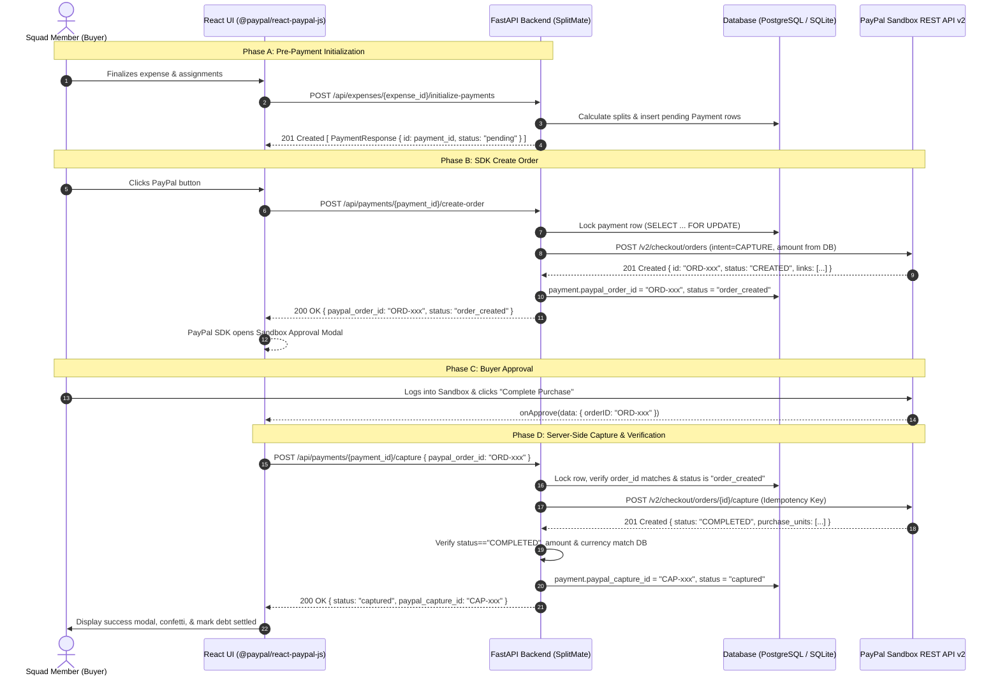

# SplitMate – PayPal React Integration Contract

**Document Version:** 1.0.0  
**Target Deadline:** November 13, 2026  
**Module Owner (PayPal Integration Lead):** Tanay  
**Frontend Collaborator:** Dhruv  
**Backend Architect:** Tanishq  

---

## 1. Executive Summary & Architecture Flow

This document defines the formal integration contract for embedding the official PayPal JavaScript SDK via `@paypal/react-paypal-js` into the SplitMate React application.

### Strict Security Boundary: Server-Side Capture Principle
In SplitMate, **the frontend NEVER executes payment authorizations or captures directly with PayPal**.  
- The backend owns the confidential `PAYPAL_CLIENT_SECRET`.
- The backend queries the database for the authoritative amount and currency.
- The React frontend acts strictly as a UI orchestrator, rendering PayPal buttons and relaying order IDs between FastAPI and the PayPal JS SDK.
- The backend conducts server-side verification of capture status, amount, currency, and group membership before marking any record `CAPTURED`.



---

## 2. Pre-Payment Initialization Lifecycle

Before any PayPal order can be created, a `Payment` entity must exist in the database with status `pending`.

### Sequence of Events
1. **Expense Created & Receipt Items Assigned**:
   - Pawan's AI extracts receipt items (`POST /api/receipts/{receipt_id}/extraction`).
   - Members are assigned to line items (`POST /api/expenses/{expense_id}/assignments/batch`).
   - Every receipt item must be 100% assigned; partial or over-assignments are strictly rejected.
2. **Finalization & Payment Initialization**:
   - The frontend triggers payment initialization:
     ```http
     POST /api/expenses/{expense_id}/initialize-payments
     ```
   - Tanishq's backend calculates each member's exact financial share (proportional subtotal, proportional tax/tip, and exact penny-rounding reconciliation).
   - The backend creates or updates `Payment` records in state `pending` and returns them.
3. **Capture Payment ID**:
   - The frontend stores the returned `payment.id` on each member's debt card/row.
   - When the debtor initiates payment, `payment.id` is supplied to the payment endpoints.

---

## 3. Exact API Contracts & Endpoints

### 3.1. Primary RESTful Endpoints (Recommended)

#### A. Create PayPal Order
- **URL:** `POST /api/payments/{payment_id}/create-order`
- **Request Headers:**
  - `Content-Type: application/json`
  - `Authorization: Bearer <token>` *(Future JWT requirement)*
- **Request Body (`PaymentCreateOrderRequest`):**
  ```json
  {
    "member_id": "3bf54bb5-3dc0-4581-9b65-ea933b9c7b64",
    "return_url": "https://splitmate.io/payment/success",
    "cancel_url": "https://splitmate.io/payment/cancel"
  }
  ```
  *(All body fields are optional. `member_id` acts as an authorization hint).*
- **Response (`200 OK`, `PaymentResponse`):**
  ```json
  {
    "id": "e93817f2-1a48-4cb2-850d-b4b1a4157121",
    "expense_id": "673f8a0a-bf19-4cb5-8278-f71694b7dc6a",
    "member_id": "3bf54bb5-3dc0-4581-9b65-ea933b9c7b64",
    "amount": 29.70,
    "currency": "USD",
    "paypal_order_id": "5O190127TN364715T",
    "paypal_capture_id": null,
    "status": "order_created",
    "approval_url": "https://www.sandbox.paypal.com/checkoutnow?token=5O190127TN364715T",
    "created_at": "2026-11-10T10:00:00Z",
    "updated_at": "2026-11-10T10:00:01Z"
  }
  ```

#### B. Capture PayPal Order
- **URL:** `POST /api/payments/{payment_id}/capture`
- **Request Body (`PaymentCaptureRequest`):**
  ```json
  {
    "paypal_order_id": "5O190127TN364715T",
    "member_id": "3bf54bb5-3dc0-4581-9b65-ea933b9c7b64"
  }
  ```
- **Response (`200 OK`, `PaymentResponse`):**
  ```json
  {
    "id": "e93817f2-1a48-4cb2-850d-b4b1a4157121",
    "expense_id": "673f8a0a-bf19-4cb5-8278-f71694b7dc6a",
    "member_id": "3bf54bb5-3dc0-4581-9b65-ea933b9c7b64",
    "amount": 29.70,
    "currency": "USD",
    "paypal_order_id": "5O190127TN364715T",
    "paypal_capture_id": "1AB23456CD789012E",
    "status": "captured",
    "approval_url": null,
    "created_at": "2026-11-10T10:00:00Z",
    "updated_at": "2026-11-10T10:01:15Z"
  }
  ```

---

### 3.2. Compatibility Endpoints (Dhruv's Direct Routes)

For zero-friction frontend compatibility, the backend also exposes direct routes accepting camelCase or snake_case payload aliases.

#### A. Direct Create Order
- **URL:** `POST /api/payments/paypal/create-order`
- **Request Body (`PaymentDirectCreateOrderRequest`):**
  ```json
  {
    "paymentId": "e93817f2-1a48-4cb2-850d-b4b1a4157121",
    "payerId": "3bf54bb5-3dc0-4581-9b65-ea933b9c7b64",
    "expenseId": "673f8a0a-bf19-4cb5-8278-f71694b7dc6a"
  }
  ```
  *(Note: `amount`, `currency`, and `receiverEmail` may be sent by existing React contexts, but are safely ignored by the backend in favor of database values).*
- **Response:** Identical `PaymentResponse` schema.

#### B. Direct Capture Order
- **URL:** `POST /api/payments/paypal/capture-order`
- **Request Body (`PaymentDirectCaptureRequest`):**
  ```json
  {
    "orderId": "5O190127TN364715T",
    "paymentId": "e93817f2-1a48-4cb2-850d-b4b1a4157121",
    "payerId": "3bf54bb5-3dc0-4581-9b65-ea933b9c7b64"
  }
  ```
- **Response:** Identical `PaymentResponse` schema.

---

### 3.3. Payment Status & History Query
- **Single Payment:** `GET /api/payments/{payment_id}`
- **Payment History:** `GET /api/payments/history` (Returns latest 100 payments, newest first).

---

## 4. Backend Verification Guarantees

The backend enforces 7 layers of financial verification:

1. **Order & Group Ownership**:
   Verifies that `payment.expense.group_id == payment.member.group_id`. Rejects unauthorized cross-group manipulations with `403 Forbidden`.
2. **Payment Ownership**:
   If `member_id` is passed, the backend validates `payment.member_id == caller.member_id`.
3. **PayPal Order ID Matching**:
   Capture requires `body.paypal_order_id == payment.paypal_order_id`. Rejects mismatches with `400 Bad Request`.
4. **Amount & Currency Integrity**:
   Inspects PayPal's capture payload down to the cent. If `captured_amount != payment.amount` or `captured_currency != payment.currency`, the transaction is failed with `400 Bad Request`.
5. **Concurrency & Duplicate Capture Protection**:
   - Uses SQLAlchemy `with_for_update()` row-level locking on `payments` table.
   - If payment status is already `CAPTURED`, returns `409 Conflict`.
   - Sends deterministic `PayPal-Request-Id` idempotency keys: `order_{payment.id}` and `capture_{payment.id}_{order_id}`.
6. **Network Timeout & State Reconciliation**:
   - If a network error or timeout occurs during capture, the backend returns `504 Gateway Timeout` and **preserves status as `order_created`** (never marks `failed` prematurely).
   - If a retry encounters PayPal error `ORDER_ALREADY_CAPTURED`, the backend automatically calls `get_order_details()`, reconciles the existing capture status, and commits `captured`.
7. **Database Transaction Consistency**:
   All DB write operations feature explicit `db.rollback()` blocks to prevent orphan transactions or locked connection pools.

---

## 5. React Integration Guide (`@paypal/react-paypal-js`)

### 5.1. Setup & Installation
Install the official PayPal React package:
```bash
npm install @paypal/react-paypal-js
```

In `.env`:
```env
VITE_PAYPAL_CLIENT_ID=your_sandbox_client_id_here
VITE_API_BASE_URL=http://localhost:8000/api
```
*(The Client ID is safe for frontend exposure; Client Secret remains strictly backend-only).*

### 5.2. Provider Wrapping
Wrap the payment modal or the application root with `<PayPalScriptProvider>`:

```jsx
import { PayPalScriptProvider } from "@paypal/react-paypal-js";

const initialOptions = {
  clientId: import.meta.env.VITE_PAYPAL_CLIENT_ID,
  currency: "USD",
  intent: "capture",
  components: "buttons",
};

export function App() {
  return (
    <PayPalScriptProvider options={initialOptions}>
      <MainLayout />
    </PayPalScriptProvider>
  );
}
```

### 5.3. PayPalButtons Implementation Pattern

```jsx
import React, { useState } from 'react';
import { PayPalButtons } from '@paypal/react-paypal-js';
import { apiClient } from '../../api/client';
import { API_ENDPOINTS } from '../../api/endpoints';

export default function PayPalButtonWrapper({ paymentId, payerMemberId, onPaymentComplete }) {
  const [errorMessage, setErrorMessage] = useState(null);
  const [isVerifying, setIsVerifying] = useState(false);

  /**
   * Step 1: createOrder callback
   * Invoked when buyer clicks the PayPal button.
   * Calls FastAPI backend to create PayPal order and returns paypal_order_id.
   */
  const handleCreateOrder = async (data, actions) => {
    setErrorMessage(null);
    try {
      const response = await apiClient.request(`/payments/${paymentId}/create-order`, {
        method: 'POST',
        body: JSON.stringify({
          member_id: payerMemberId,
        }),
      });

      // Must return the exact string paypal_order_id
      return response.paypal_order_id;
    } catch (err) {
      setErrorMessage(err.message || 'Failed to initiate PayPal order.');
      throw err; // Signals PayPal SDK to abort checkout popup
    }
  };

  /**
   * Step 2: onApprove callback
   * Invoked when buyer approves payment inside the PayPal Sandbox popup.
   * Calls FastAPI backend to capture and verify.
   */
  const handleApprove = async (data, actions) => {
    setIsVerifying(true);
    try {
      const captureResponse = await apiClient.request(`/payments/${paymentId}/capture`, {
        method: 'POST',
        body: JSON.stringify({
          paypal_order_id: data.orderID, // Captured from PayPal SDK
          member_id: payerMemberId,
        }),
      });

      if (captureResponse.status === 'captured') {
        onPaymentComplete({
          success: true,
          captureId: captureResponse.paypal_capture_id,
          orderId: captureResponse.paypal_order_id,
        });
      } else {
        throw new Error(`Payment ended in unexpected status: ${captureResponse.status}`);
      }
    } catch (err) {
      if (err.message?.includes('504') || err.message?.includes('timed out')) {
        // Special case: 504 Timeout requires status reconciliation check
        setErrorMessage('Network timeout while confirming payment. Please check your history before retrying.');
      } else {
        setErrorMessage(err.message || 'Payment capture failed.');
      }
    } finally {
      setIsVerifying(false);
    }
  };

  /**
   * Step 3: onCancel callback
   * Invoked if buyer exits or closes the PayPal modal without completing approval.
   */
  const handleCancel = (data) => {
    console.info('PayPal checkout cancelled by user:', data);
    setErrorMessage('Checkout was cancelled. You have not been charged.');
  };

  /**
   * Step 4: onError callback
   * Catches SDK-level errors, pop-up blockers, or invalid client credentials.
   */
  const handleError = (err) => {
    console.error('PayPal SDK error event:', err);
    setErrorMessage('PayPal service encountered an error. Please try again.');
  };

  return (
    <div className="paypal-button-container space-y-3">
      {errorMessage && (
        <div className="p-3 bg-rose-50 text-rose-700 text-xs rounded-xl border border-rose-200">
          {errorMessage}
        </div>
      )}

      {isVerifying ? (
        <div className="flex items-center justify-center py-4 text-xs font-semibold text-slate-600">
          <span className="animate-spin mr-2">⏳</span> Verifying PayPal Sandbox settlement...
        </div>
      ) : (
        <PayPalButtons
          style={{ layout: 'vertical', shape: 'rect', color: 'blue', label: 'pay' }}
          createOrder={handleCreateOrder}
          onApprove={handleApprove}
          onCancel={handleCancel}
          onError={handleError}
        />
      )}
    </div>
  );
}
```

---

## 6. Frontend Status & Error Handling Matrix

| HTTP Status | Condition | Backend State | Frontend Presentation & Action |
|-------------|-----------|---------------|--------------------------------|
| `200 OK` | Capture successful | `status: "captured"` | Show success modal, confetti, update split debt to settled. |
| `400 Bad Request` | Amount/currency mismatch or mismatched `order_id` | `status: "failed"` | Display "Payment rejected: security parameter mismatch." Do not retry with same order. |
| `403 Forbidden` | Member does not belong to group or caller mismatch | Unchanged | Display "Unauthorized payment attempt." |
| `404 Not Found` | Payment ID not found | None | Display "Payment record does not exist. Please re-open the expense." |
| `409 Conflict` | Payment already captured or duplicate create | `status: "captured"` | Refresh expense state from server; mark already paid. |
| `502 Bad Gateway` | PayPal Sandbox API error (bad credentials/downtime) | Unchanged / `failed` | Display "PayPal Sandbox currently unavailable. Please try again shortly." |
| `504 Gateway Timeout` | Network timeout during capture call | **Stays `order_created`** | Display "Verifying payment with PayPal...". Poll `GET /api/payments/{payment_id}`. **Do NOT mark failed!** |

---

## 7. Authentication Dependencies Requiring Tanishq's Approval

> [!WARNING]
> **Current Authentication Limitation:**  
> The backend database currently models `GroupMember` without an authenticated `User` table or JWT verification. The frontend mock currently switches users via `localStorage`.

### Current Mitigation
- The backend performs group integrity validation (`payment.expense.group_id == payment.member.group_id`).
- The backend verifies that the caller-supplied `member_id` matches `payment.member_id`.
- Financial amounts and currencies are completely isolated from client tampering.

### Required Architecture Roadmap with Tanishq
1. **User Authentication Service**: Tanishq to introduce a `users` table and issue signed JWT tokens (`/api/auth/login`).
2. **Member Linkage**: Link `GroupMember.user_id -> users.id`.
3. **Dependency Injection**: Replace `body.member_id` with FastAPI dependency:
   ```python
   current_user: User = Depends(get_current_user)
   if payment.member.user_id != current_user.id:
       raise HTTPException(status_code=403, detail="Forbidden")
   ```
4. Until JWT authentication is finalized, frontend requests should pass `member_id` in request bodies as an authorization hint.

---

## 8. Frontend Integration Checklist for Dhruv

- [ ] **Remove Mock Interceptors**: Delete lines 205–229 in `frontend/src/api/client.js` so requests reach FastAPI.
- [ ] **Field Aliases**: Verify frontend consumes `paypal_order_id` and `paypal_capture_id` from responses.
- [ ] **Install SDK**: Add `@paypal/react-paypal-js` to `frontend/package.json`.
- [ ] **Client ID Config**: Add `VITE_PAYPAL_CLIENT_ID` to `frontend/.env`.
- [ ] **Expense Settlement Hook**: Ensure `POST /api/expenses/{expense_id}/initialize-payments` is invoked after receipt split assignment.
- [ ] **504 Recovery**: Implement polling for `504 Gateway Timeout` responses.

