# SPLITMATE — PHASE 6: PROPOSED PRODUCTION REMEDIATION PLAN

**Date:** November 11, 2026
**Document Version:** 1.0.0
**Document Role:** Original Proposed Remediation Plan
**Status:** **HISTORICAL SPECIFICATION — PROPOSAL APPROVED & IMPLEMENTATION RECORDED IN FINAL REPORT**
**Implementation Outcome Reference:** See `docs/PHASE6_FINAL_REPORT.md` for completed implementation details and verification results.
**Target Environment:**
- **Frontend Hosting:** Vercel (Edge CDN, SPA routing)
- **Backend Hosting:** Render (Gunicorn + Uvicorn multi-worker ASGI)
- **Database:** Neon Serverless PostgreSQL 15+ (SSL required, connection pooling)
- **Receipt Storage:** Cloudflare R2 (S3-compatible persistent object store)
- **Authentication:** Stateless signed JSON Web Tokens (JWT, HS256, 24-hour expiration)
- **PayPal Integration:** PayPal Sandbox REST API (strict non-live enforcement)

---

## 1. Remediation Plan Overview & Phasing

> [!NOTE]
> **Original Proposed Plan Notice:**
> This document is the **original proposed remediation plan** prepared following the initial deployment audit (`docs/PHASE6_DEPLOYMENT_AUDIT.md`) and approved prior to development.
>
> It outlines the proposed architectural designs, task sequences, risks, and verification procedures. For the actual implementation outcomes, finalized file changes, and full test suite metrics (170/170 tests passing), refer to the Phase 6 final report in `docs/PHASE6_FINAL_REPORT.md`.

This remediation plan organizes all **24 issues** identified in the Phase 6 Deployment Audit into a phased, zero-downtime implementation schedule. Each task details:
1. Exact affected files.
2. Step-by-step code and configuration modifications.
3. Identified regression risks.
4. Rollback procedures for failure recovery.
5. Exact validation commands and test assertions.

```mermaid
flowchart TD
    subgraph Phase1["Phase 1: Critical Security & Auth (Issues 1-7)"]
        T1["Task 1.1: Untrack Git DB Files (ISSUE-07)"]
        T2["Task 1.2: Stateless JWT Authentication (ISSUE-03)"]
        T3["Task 1.3: Neon PostgreSQL & Alembic (ISSUE-04, 05)"]
        T4["Task 1.4: Production CORS & Host Whitelist (ISSUE-06)"]
        T5["Task 1.5: Production Flags & Gunicorn (ISSUE-02)"]
        T6["Task 1.6: Vercel SPA Config & API URL (ISSUE-01)"]
    end

    subgraph Phase2["Phase 2: High Priority Hardening (Issues 8-15)"]
        T7["Task 2.1: Protected Route Authorization (ISSUE-14)"]
        T8["Task 2.2: Cloudflare R2 Storage Adapter (ISSUE-15)"]
        T9["Task 2.3: Headless OpenCV Dependency (ISSUE-12)"]
        T10["Task 2.4: Multi-Worker Lifespan Guard (ISSUE-11)"]
        T11["Task 2.5: Multi-Worker ASGI Runner (ISSUE-10)"]
        T12["Task 2.6: Production Mock Fallback Gate (ISSUE-08)"]
        T13["Task 2.7: Complete Environment Templates (ISSUE-13)"]
        T14["Task 2.8: Vercel Rewrite Rules (ISSUE-09)"]
    end

    subgraph Phase3["Phase 3: Observability & Resilience (Issues 16-24)"]
        T15["Task 3.1: Rate Limiting & CSP (ISSUE-16, 17)"]
        T16["Task 3.2: Production PayPal Strict Mode (ISSUE-18, 23)"]
        T17["Task 3.3: Structured JSON Logging (ISSUE-19)"]
        T18["Task 3.4: Asynchronous OCR Queueing (ISSUE-21)"]
        T19["Task 3.5: GitHub Actions CI/CD Pipeline (ISSUE-20)"]
    end

    Phase1 --> Phase2 --> Phase3
```



---

## 2. Phase 1: Critical Remediation Tasks (Blockers)

---

### Task 1.1: Untrack Local Database Files from Version Control
* **Issues Addressed:** `ISSUE-07` (Critical)
* **Goal:** Remove `backend/splitmate.db` and `backend/test.db` from git index while keeping local files intact on disk.
* **Affected Files:**
  - Git index only (no source code change)
  - Verify `.gitignore`
* **Implementation Steps:**
  1. Remove cached databases from git tracking:
     ```bash
     git rm --cached backend/splitmate.db backend/test.db
     ```
  2. Verify that `*.db` remains in `.gitignore`.
  3. Commit untracking change.
* **Risk & Mitigation:**
  - *Risk:* Deleting physical local files by mistake.
  - *Mitigation:* Explicitly use `--cached` flag so files remain on local disk.
* **Verification Command:**
  ```bash
  git status --short
  # Output must show: D  backend/splitmate.db, D  backend/test.db (staged for deletion from repo only)
  ```

---

### Task 1.2: Implement Stateless Cryptographically Signed JWT Authentication
* **Issues Addressed:** `ISSUE-03` (Critical)
* **Goal:** Replace the single-process in-memory `_ACTIVE_SESSIONS` dictionary with signed HS256 JSON Web Tokens with a 24-hour expiration window.
* **Approved Architecture:** Stateless JWT (`PyJWT` / `python-jose`), 24h validity, claims: `sub` (user_id), `email`, `name`, `exp`, `iat`.
* **Affected Files:**
  - `backend/requirements.txt` (add `pyjwt>=2.9.0`)
  - `backend/app/core/config.py` (add `JWT_SECRET_KEY`, `JWT_ALGORITHM = "HS256"`, `ACCESS_TOKEN_EXPIRE_MINUTES = 1440`)
  - `backend/app/core/security.py` (add `create_access_token()`, `decode_access_token()`)
  - `backend/app/api/routes/auth.py` (update `get_current_user`, `login_user`, `register_user`, deprecate `_ACTIVE_SESSIONS`)
  - `backend/tests/test_auth.py` (unit tests for token expiry, signature validation, tampering rejection)
* **Implementation Steps:**
  1. Add `pyjwt>=2.9.0` to `backend/requirements.txt`.
  2. In `backend/app/core/security.py`:
     ```python
     import jwt
     from datetime import datetime, timedelta, timezone

     def create_access_token(data: dict, expires_delta: timedelta | None = None) -> str:
         to_encode = data.copy()
         expire = datetime.now(timezone.utc) + (expires_delta or timedelta(hours=24))
         to_encode.update({"exp": expire, "iat": datetime.now(timezone.utc)})
         return jwt.encode(to_encode, settings.JWT_SECRET_KEY, algorithm=settings.JWT_ALGORITHM)

     def decode_access_token(token: str) -> dict:
         return jwt.decode(token, settings.JWT_SECRET_KEY, algorithms=[settings.JWT_ALGORITHM])
     ```
  3. In `backend/app/api/routes/auth.py`:
     - Update `get_current_user()` to decode and verify JWT signature and expiration.
     - Extract `user_id` from token `sub` claim.
     - Remove `_ACTIVE_SESSIONS` global dict.
* **Risk & Mitigation:**
  - *Risk:* Invalidation of active sessions during transition.
  - *Mitigation:* Users will receive standard 401 and log in once to obtain signed JWT.
* **Rollback Procedure:**
  - Revert `auth.py` and `security.py` to in-memory dictionary backup.
* **Verification Commands:**
  ```bash
  pytest tests/test_auth.py -v
  pytest tests/test_security.py -v
  ```

---

### Task 1.3: Configure Neon Serverless PostgreSQL & Database Migration Isolation
* **Issues Addressed:** `ISSUE-04` (Critical), `ISSUE-05` (Critical)
* **Goal:** Provide seamless support for Neon PostgreSQL with SSL enforcement, connection pooling, and managed Alembic execution.
* **Approved Architecture:** Neon Serverless PostgreSQL 15+ (`postgresql://...sslmode=require`), SQLAlchemy connection pool with `pool_pre_ping=True`, `pool_size=10`, `max_overflow=20`.
* **Affected Files:**
  - `backend/app/core/config.py` (default connection pool tuning, fallback to SQLite for local tests only)
  - `backend/app/db/session.py` (SSL configuration, pool recycling)
  - `backend/alembic.ini` & `backend/migrations/env.py` (ensure `DATABASE_URL` is parsed dynamically)
* **Implementation Steps:**
  1. In `backend/app/db/session.py`:
     ```python
     engine_kwargs = {}
     if settings.DATABASE_URL.startswith("sqlite"):
         engine_kwargs["connect_args"] = {"check_same_thread": False}
     else:
         engine_kwargs["pool_pre_ping"] = True
         engine_kwargs["pool_size"] = 10
         engine_kwargs["max_overflow"] = 20
         engine_kwargs["pool_recycle"] = 300  # Recycle connections before Neon timeout
     ```
  2. Verify Alembic migrations compatibility with PostgreSQL UUID and ENUM types.
  3. Define pre-deployment database migration command:
     ```bash
     alembic upgrade head
     ```
* **Rollback Procedure:**
  - Revert `DATABASE_URL` to previous connection string or run `alembic downgrade -1`.
* **Verification Command:**
  ```bash
  pytest tests/test_expenses.py tests/test_groups.py -v
  ```

---

### Task 1.4: Configure Production CORS & Host Whitelist
* **Issues Addressed:** `ISSUE-06` (Critical)
* **Goal:** Enable cross-origin communication between the Vercel-hosted frontend and the Render-hosted backend while rejecting unauthorized origins.
* **Affected Files:**
  - `backend/app/core/config.py`
  - `backend/app/main.py`
  - `backend/.env.example`
* **Implementation Steps:**
  1. In `backend/app/core/config.py`, expand `cors_origin_list` to parse regex patterns or environment list:
     ```python
     CORS_ORIGIN_REGEX: str = r"^https:\/\/.*\.vercel\.app$"
     ```
  2. In `backend/app/main.py`, pass `allow_origin_regex=settings.CORS_ORIGIN_REGEX` alongside explicit `allow_origins=settings.cors_origin_list`.
  3. Support user's custom production domain (e.g. `https://splitmate.com`).
* **Risk & Mitigation:**
  - *Risk:* Overly permissive CORS allowing malicious origins.
  - *Mitigation:* Avoid wildcard `*` with credentials. Strictly allow `.vercel.app` and explicit production domains.
* **Verification Command:**
  ```bash
  pytest tests/test_receipts.py -k "cors" -v
  ```

---

### Task 1.5: Production Server Flags, Gunicorn ASGI Runner & Debug Protection
* **Issues Addressed:** `ISSUE-02` (Critical), `ISSUE-10` (High)
* **Goal:** Replace single-process `uvicorn --reload` with a multi-worker production Gunicorn setup, disabling traceback leakage.
* **Approved Architecture:** Render Web Service running `gunicorn -w 4 -k uvicorn.workers.UvicornWorker -b 0.0.0.0:$PORT app.main:app`.
* **Affected Files:**
  - `backend/requirements.txt` (add `gunicorn>=23.0.0`)
  - `backend/app/core/config.py` (enforce `DEBUG=False` when `APP_ENV=production`)
  - `backend/app/main.py` (add global uncaught exception handler masking internal errors when `DEBUG=False`)
  - Create `backend/Procfile` for Render deployment:
    ```text
    web: gunicorn -w 4 -k uvicorn.workers.UvicornWorker -b 0.0.0.0:$PORT app.main:app
    ```
* **Verification Command:**
  ```bash
  python -m gunicorn --version
  ```

---

### Task 1.6: Vercel Frontend Configuration & Production API URL Injection
* **Issues Addressed:** `ISSUE-01` (Critical), `ISSUE-09` (High)
* **Goal:** Allow dynamic production backend base URL injection during Vercel builds and ensure SPA client-side routing works on refresh.
* **Approved Architecture:** Vercel static deployment of `dist/` with `vercel.json` rewrite rules.
* **Affected Files:**
  - Create `frontend/vercel.json`
  - Update `frontend/src/api/client.js`
  - Create `frontend/.env.production`
* **Implementation Steps:**
  1. Create `frontend/vercel.json`:
     ```json
     {
       "rewrites": [
         {
           "source": "/(.*)",
           "destination": "/index.html"
         }
       ]
     }
     ```
  2. Create `frontend/.env.production`:
     ```env
     VITE_API_BASE_URL=https://splitmate-api.onrender.com/api
     VITE_USE_MOCK_API=false
     VITE_ENABLE_MOCK_FALLBACK=false
     VITE_PAYPAL_CLIENT_ID=sb
     ```
  3. Ensure `frontend/src/api/client.js` uses `import.meta.env.VITE_API_BASE_URL` cleanly without hardcoding `127.0.0.1`.
* **Verification Command:**
  ```bash
  cd frontend && npm run build
  ```

---

## 3. Phase 2: High Priority Hardening Tasks

---

### Task 2.1: Protected Route Authorization & Object Access Control
* **Issues Addressed:** `ISSUE-14` (High)
* **Goal:** Protect private expense, group, and receipt data while preserving the seamless persona switching in frontend demo mode.
* **Affected Files:**
  - `backend/app/api/routes/groups.py`
  - `backend/app/api/routes/expenses.py`
  - `backend/app/api/routes/receipts.py`
* **Implementation Steps:**
  1. Add `current_user: User | None = Depends(get_optional_current_user)` or `Depends(get_current_user)`.
  2. Enforce that destructive operations (e.g. deleting groups, editing expense shares, deleting receipts) require authentication.
  3. Support demo resilience: if `APP_ENV != "production"` and no header is provided, permit demo persona fallback for local development.
* **Verification Command:**
  ```bash
  pytest tests/test_groups.py tests/test_expenses.py -v
  ```

---

### Task 2.2: Cloudflare R2 Persistent Object Storage Adapter
* **Issues Addressed:** `ISSUE-15` (High)
* **Goal:** Store receipt scans in Cloudflare R2 object storage so files survive Render container restarts and scale across workers.
* **Approved Architecture:** Cloudflare R2 S3-compatible API via `boto3` with automatic local filesystem fallback for offline test suites.
* **Affected Files:**
  - `backend/requirements.txt` (add `boto3>=1.35.0`)
  - `backend/app/core/config.py` (add `R2_ACCOUNT_ID`, `R2_ACCESS_KEY_ID`, `R2_SECRET_ACCESS_KEY`, `R2_BUCKET_NAME`, `R2_PUBLIC_DOMAIN`)
  - Create `backend/app/services/storage.py` (unified storage adapter: R2 when configured, local disk when testing)
  - `backend/app/api/routes/receipts.py` (use storage service for upload and stream)
* **Implementation Details (`storage.py`):**
  ```python
  class StorageService:
      def save_file(self, content: bytes, filename: str) -> str: ...
      def get_file(self, file_path_or_key: str) -> bytes: ...
  ```
* **Verification Command:**
  ```bash
  pytest tests/test_receipts.py -v
  ```

---

### Task 2.3: Headless OpenCV Dependency for Linux Containers
* **Issues Addressed:** `ISSUE-12` (High)
* **Goal:** Eliminate X11/libGL dependency errors when building and running on Render Linux containers.
* **Affected Files:**
  - `backend/requirements.txt`
* **Implementation Steps:**
  - Replace `opencv-python>=4.8.0` with `opencv-python-headless>=4.8.0`.
* **Verification Command:**
  ```bash
  python -c "import cv2; print('OpenCV headless version:', cv2.__version__)"
  ```

---

### Task 2.4: Multi-Worker Lifespan Guard for Database Migrations
* **Issues Addressed:** `ISSUE-11` (High)
* **Goal:** Prevent race conditions in `Base.metadata.create_all()` when starting 4 Gunicorn workers.
* **Affected Files:**
  - `backend/app/main.py`
* **Implementation Steps:**
  1. Gate auto-creation:
     ```python
     @asynccontextmanager
     async def lifespan(app: FastAPI):
         # Auto-create tables only in local development / SQLite mode
         if settings.DATABASE_URL.startswith("sqlite") and settings.APP_ENV != "production":
             Base.metadata.create_all(bind=engine)
         yield
     ```
  2. For production on Render, run `alembic upgrade head` in the Build Command or Release Command.
* **Verification Command:**
  ```bash
  pytest tests/test_e2e_workflow.py -v
  ```

---

### Task 2.5: Disable Silent Mock Fallback in Production
* **Issues Addressed:** `ISSUE-08` (High)
* **Goal:** Ensure client surfaces transparent errors rather than fake demo data when backend services are down.
* **Affected Files:**
  - `frontend/src/api/client.js`
* **Implementation Steps:**
  1. Add flag `const enableMockFallback = import.meta.env.VITE_ENABLE_MOCK_FALLBACK !== 'false';`.
  2. If `enableMockFallback` is false, throw a clear network error rather than returning mock personas or fake groups.
* **Verification Command:**
  ```bash
  cd frontend && npm run build
  ```

---

### Task 2.6: Complete `.env.example` Documentation
* **Issues Addressed:** `ISSUE-13` (High)
* **Goal:** Document all required production environment variables for Render, Vercel, Neon, and R2.
* **Affected Files:**
  - `backend/.env.example`
  - `frontend/.env.example`
* **Implementation Steps:**
  - Add `JWT_SECRET_KEY`, `GEMINI_API_KEY`, `GEMINI_MODEL`, `R2_ACCESS_KEY_ID`, `R2_SECRET_ACCESS_KEY`, `R2_BUCKET_NAME`, `PAYPAL_MOCK_MODE`.

---

## 4. Phase 3: Observability, Security & Resilience (Medium/Low)

---

### Task 3.1: Brute-Force Rate Limiting & Content Security Policy
* **Issues Addressed:** `ISSUE-16` (Medium), `ISSUE-17` (Medium)
* **Goal:** Protect `/api/auth/login` from brute-force dictionary attacks and add CSP headers to the frontend.
* **Affected Files:**
  - `backend/requirements.txt` (add `slowapi>=0.1.9`)
  - `backend/app/main.py` (attach SlowAPI Limiter)
  - `backend/app/api/routes/auth.py` (`@limiter.limit("5/minute")` on login)
  - `frontend/index.html` (add standard CSP `<meta>` tags)

---

### Task 3.2: Production PayPal Sandbox Enforcement & Error Transparency
* **Issues Addressed:** `ISSUE-18` (Medium), `ISSUE-23` (Low)
* **Goal:** Ensure PayPal operations strictly use Sandbox and fail with honest 502/503 errors if credentials are missing or invalid (no silent mock capture).
* **Affected Files:**
  - `backend/app/services/paypal.py`
  - `backend/app/core/config.py`

---

### Task 3.3: Structured JSON Logging & Request ID Tracing
* **Issues Addressed:** `ISSUE-19` (Medium)
* **Goal:** Enable CloudWatch/Render log aggregation with request correlation IDs.
* **Affected Files:**
  - `backend/app/main.py` (middleware to add `X-Request-ID`)
  - `backend/app/core/logging_config.py`

---

### Task 3.4: Automated GitHub Actions CI/CD Pipeline
* **Issues Addressed:** `ISSUE-20` (Medium)
* **Goal:** Prevent broken builds from ever reaching Vercel or Render.
* **Affected Files:**
  - Create `.github/workflows/ci.yml` (runs `pytest` on Python 3.13 and `npm run build` on Node 20)

---

## 5. Verification Matrix & Test Strategy

| Test Domain | Target | Verification Command | Expected Outcome |
|---|---|---|---|
| **Untracked DBs** | Git clean state | `git status --short` | No tracked `.db` files |
| **JWT Authentication** | Expiry, signature, tampered tokens | `pytest tests/test_auth.py tests/test_security.py -v` | All pass |
| **Receipt Extraction** | RapidOCR + Gemini fallback | `pytest tests/test_ai_extractor.py -v` | 30/30 pass |
| **Receipts API** | Uploads, storage adapter, extraction | `pytest tests/test_receipts.py -v` | 22/22 pass |
| **End-to-End Workflow** | Group creation, splits, payments | `pytest tests/test_e2e_workflow.py -v` | All pass |
| **Frontend Production Build** | Static bundle compilation | `cd frontend && npm run build` | Zero errors / 0 warnings |
| **Total Test Suite** | Full backend test suite | `pytest -v` | **52+ tests passing** |

---

## 6. Execution Safety Rules

> [!IMPORTANT]
> The following strict constraints will govern the implementation of this plan once approved:
> 1. **No External Deployment:** No code will be pushed to Vercel or Render during remediation.
> 2. **No Paid Services:** No paid accounts or API credentials will be requested or activated.
> 3. **PayPal Sandbox Preserved:** `PAYPAL_BASE_URL` will remain strictly pointed to `api-m.sandbox.paypal.com`.
> 4. **No Data Loss:** Existing `backend/splitmate.db` and uploaded sample receipt files will not be deleted from disk.
> 5. **Backward Compatibility:** All existing tests and demo modes will remain functional.

---

## 7. Approval & Implementation Reference

> [!NOTE]
> **Implementation Complete:**
> This remediation plan was reviewed and approved. Implementation of Phases 1, 2, and 3 has been completed and verified against all automated test suites. The implementation outcomes and live deployment guides are recorded in `docs/PHASE6_FINAL_REPORT.md`.
